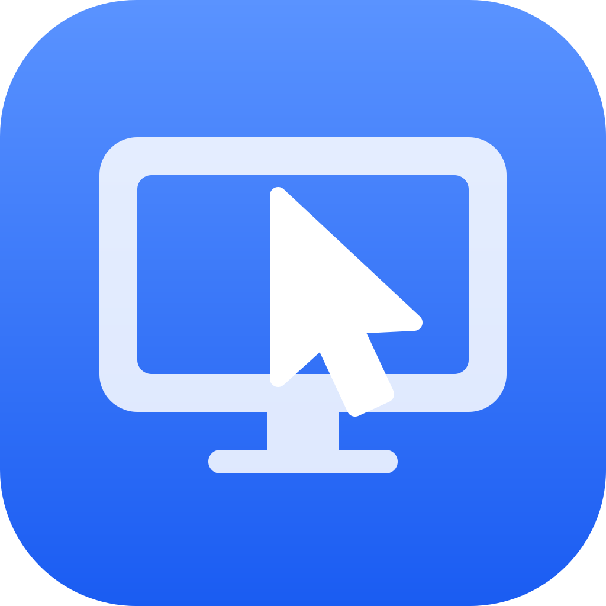

<p align="center">
  
</p>

<h1 align="center">VNC Glass</h1>

<p align="center">
  A native VNC viewer for macOS 26, built for controlling Linux desktops.
</p>

<p align="center">
  <a href="https://github.com/JulesEfrei/vnc-glass/actions/workflows/ci.yml"></a>
  <a href="https://github.com/JulesEfrei/vnc-glass/releases/latest"></a>
  
</p>

---

Most VNC viewers on the Mac lose the keyboard: ⌘Tab switches local apps, ⌘Space opens Spotlight, and ⌘ never reaches the remote as Super. VNC Glass captures every key in **Lock Mode** and maps Mac modifiers to the ones a Linux desktop expects. It is developed against [wayvnc](https://github.com/any1/wayvnc) and works with other RFB servers.

## Features

- **Lock Mode**: every keystroke, including system shortcuts like ⌘Tab, ⌘Space and Mission Control, goes to the remote computer. Toggle it with the **Unlock Shortcut** (left ⌃⌥ by default, configurable in Settings). When the window loses focus, Lock Mode pauses and resumes on its own.
- **Keyboard Profiles** per Connection: ⌘ as Super, or ⌘ as Ctrl for Mac-style shortcuts. Keys are sent as QEMU scancodes, so layouts behave like a local keyboard.
- **Display Sizing** per Connection: *Scale to Fit* keeps the remote resolution, *Match Window* resizes the remote desktop to the window.
- **Clipboard sync** in both directions, with full UTF-8 (accents and emoji) through Extended Clipboard.
- **Secure login to wayvnc** over RSA-AES, with the server key trusted on first use.
- **Saved Connections** with passwords kept in the Keychain.
- **Automatic reconnect**: a dropped Session retries for about 30 seconds over its last frame.
- Locally drawn remote cursor, trackpad scrolling, and a compact Liquid Glass toolbar.

## Installation

Requires macOS 26 or later.

1. Download `VNCGlass.dmg` from the [latest release](https://github.com/JulesEfrei/vnc-glass/releases/latest).
2. Open the DMG and drag **VNC Glass** to **Applications**.
3. Open VNC Glass. Builds are not notarized yet, so macOS blocks the first launch. Go to **System Settings › Privacy & Security** and click **Open Anyway**.
4. For Lock Mode, turn on VNC Glass in **System Settings › Privacy & Security › Accessibility**. The app asks the first time you lock a Session.

Every green build of `main` publishes a new release.

### Server setup (wayvnc)

VNC Glass logs in to wayvnc with `enable_auth=true` over RSA-AES. VeNCrypt/TLS is not supported (see [ADR-0003](docs/adr/0003-rsa-aes-not-vencrypt.md)). Without a login (`enable_auth=false`), keep the server on a private network such as Tailscale.

## Building from source

You need Xcode 26 and [XcodeGen](https://github.com/yonaskolb/XcodeGen).

```sh
git clone https://github.com/JulesEfrei/vnc-glass.git
cd vnc-glass
brew install xcodegen
xcodegen generate        # writes VNCGlass.xcodeproj from project.yml
open VNCGlass.xcodeproj
```

Run the **VNCGlass** scheme. The Xcode project is generated, so change `project.yml`, not the `.xcodeproj`.

### Tests

```sh
swift test --package-path Packages/SessionCore
swift test --package-path Packages/RoyalVNCKit
```

SessionCore tests run against `FakeRFBServer`, an in-process RFB server, so they need no real VNC server.

## Project layout

| Path | Contents |
| --- | --- |
| `App/` | The macOS SwiftUI app, a thin AppKit edge over the Session core. |
| `Packages/SessionCore` | The platform-agnostic Session core, plus `FakeRFBServer` for tests. |
| `Packages/RoyalVNCKit` | Vendored RoyalVNCKit with added protocol features ([ADR-0002](docs/adr/0002-vendor-royalvnckit.md), see its `VENDORED.md`). |
| `GLOSSARY.md` | The project's vocabulary: Connection, Session, Lock Mode, and so on. |
| `docs/adr/` | Architecture decision records. |

## Contributing

Contributions are welcome.

1. Check [the issues](https://github.com/JulesEfrei/vnc-glass/issues) or open one to discuss the change first. Issues labeled `ready-for-human` are open for contributors.
2. Read [`GLOSSARY.md`](GLOSSARY.md) and use its terms in code, commits and issues. Write "Session", not "tab"; write "Connection", not "host".
3. Fork the repo and create a branch from `main`.
4. Keep the platform-agnostic logic in `SessionCore` and cover it with tests against `FakeRFBServer`. Keep `App/` a thin layer over it.
5. Run both test suites before pushing. CI runs them on every branch.
6. Write commit messages as `type: what changed, so <why it matters>`, for example `fix: keep the RSA-AES stream in order, so wayvnc stops hanging up mid-Session`.
7. Open a pull request against `main`.

If your change makes a decision that is hard to reverse, add an ADR in `docs/adr/`.

## Acknowledgements

VNC Glass builds on [RoyalVNCKit](https://github.com/royalapplications/royalvnc) by Royal Apps (MIT).
